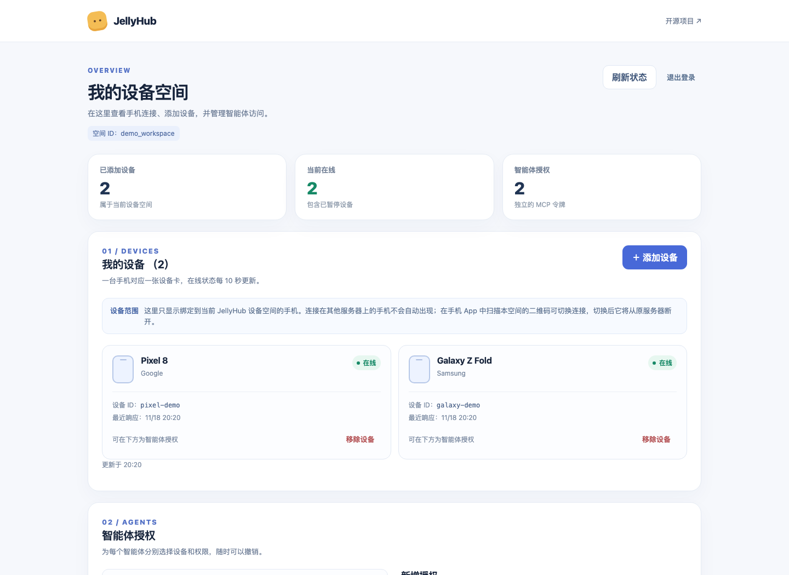
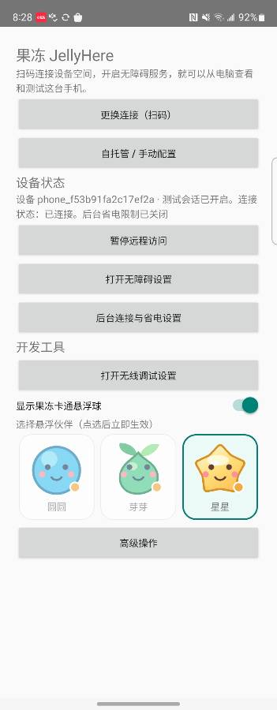

# 果冻 JellyHere

**让智能体，从对话走向行动。**

[](https://github.com/AsCat/jellyhere/actions/workflows/ci.yml) · [Apache-2.0](LICENSE) · Android first · Open source

JellyHere 让 Codex 等通用智能体按需理解手机屏幕、读取界面元素，并在用户允许时点击、滑动、输入和返回结果。Android 手机与电脑分别连接 Go 中转服务，**即使不在同一局域网，运行时也不需要无线 ADB**。项目从开发测试起步，目标是成为智能体连接个人设备的开放入口。

[快速开始](docs/quickstart.md) · [自托管](docs/self-host.md) · [MCP 接入](docs/client-setup.md) · [CLI 与无线调试](docs/shortcuts.md) · [路线图](docs/roadmap.md)

## 看看果冻

<p align="center"></p>
<p align="center"><sub>JellyHub 控制台 · 演示数据，展示多设备状态与智能体授权</sub></p>

<p align="center"></p>
<p align="center"><sub>Android App · 三星真机截图，未展示授权令牌</sub></p>

## 从一次无线调试重连开始

做 Android 开发时，手机换了 Wi-Fi 或网络环境，无线调试入口和动态端口经常要重新确认。原本只想继续写代码，却得拿起手机，进入开发者选项、打开无线调试、抄下端口，再回到电脑执行 `adb connect`。这件小事重复得足够多，就成了果冻最早要解决的痛点。

于是有了快捷动作：手机端可从悬浮角色打开无线调试；电脑端的 `jellyhere adb connect` 会先确认目标设备在线，再读取当前界面、寻找系统开关、取回**当次**端口并连接 ADB。它会核对操作结果，找不到可靠控件时停下交给用户处理，不沿用过期端口，也不盲点坐标。

继续做下去发现，更有价值的是那条始终可用的设备通道。手机主动通过 WSS 连接中转服务；智能体通过 MCP 查看屏幕和界面树、执行一次操作、再读回结果。无线调试成了其中一个开发快捷动作，而果冻逐渐长出了多设备管理、扫码绑定、独立授权，以及能在手机上随时暂停智能体的悬浮角色。它正在从开发者的小工具，走向可按需使用手机的开源智能体助手。

**今天它服务于 Android 开发测试；未来希望让智能体在用户掌控下，安全地走向更多设备和真实任务。**

## 现在能做什么

| 能力 | 当前实现 |
| --- | --- |
| 跨网络连接 | Android 主动连 Go relay；智能体通过 HTTPS MCP 接入，双方无需同一局域网 |
| 理解屏幕 | `get_screen` 返回无障碍界面树和可选的压缩截图；只需元素时可关闭图片 |
| 操作界面 | 按元素路径点击，或执行坐标点击、滑动、输入、返回与主页；界面变化后重新读屏 |
| 多设备 | 为每台设备指定 ID；JellyHub 可查看在线状态，并给每个智能体单独选择设备与只读/控制权限 |
| 手机端控制 | 星星等悬浮角色可贴边、显示状态和暂停远程访问；提供无线调试快捷入口 |
| 开发者 CLI | `jellyhere doctor` 检查连接；`jellyhere adb connect --device <id>` 按需恢复本地 ADB |

果冻的 WSS 中转**不转发 ADB 流量**：最后的 `adb connect` 仍要求电脑能访问手机的无线调试端点。手机端无障碍服务也需要用户首次在 Android 设置中手动启用。[能力边界与操作说明](docs/client-setup.md)

## 三步上手

1. **选择入口。** 可以[自行部署轻量 Go relay](docs/self-host.md)，也可以使用你信任的 JellyHub 托管实例。自托管适合个人设备；JellyHub 托管试验按账户隔离设备，支持扫码加入。[托管模式说明](docs/managed-pilot.md)
2. **连接 Android。** 安装果冻 App，开启无障碍服务并连接 relay。托管模式用二维码绑定；自托管模式手动填写服务器地址与设备令牌。[Android 安装步骤](docs/quickstart.md)
3. **授权智能体。** 为 Codex 或其他支持 Streamable HTTP MCP 的客户端单独生成令牌，先调用 `device_status`，再明确指定目标 `deviceId` 读屏和操作。[MCP 配置](docs/client-setup.md)

例如，只需要识别当前界面时，可调用：

```json
{"tool":"get_screen","arguments":{"deviceId":"pixel-demo","includeImage":false,"treeMode":"compact"}}
```

需要视觉判断时再取压缩截图。点击元素优先使用读屏返回的 `revision` 和 `path`；界面变化后重新读屏。[完整工具与协议](docs/protocol.md)

## 它如何连接

```text
Android 果冻 App ── WSS / 手机移动网络 ──> Go relay / JellyHub
                                               │
Codex、其他 MCP 智能体 ── HTTPS MCP ──────────────┘
```

Go 服务不持久化屏幕内容；手机端可暂停后续读屏和操作。受 Android 保护的窗口、锁屏认证和厂商后台限制仍由系统决定，果冻不会绕过它们。[可靠性说明](docs/self-host.md) · [安全说明](SECURITY.md)

## 项目组成

| 目录 | 作用 |
| --- | --- |
| [`android/`](android/) | Android 11+ 设备端、无障碍服务、悬浮角色与无线调试快捷动作 |
| [`server/`](server/) | 单进程 Go relay、MCP 接口和 JellyHub 托管模式 |
| [`tools/`](tools/) | `jellyhere` CLI 与 ADB 重连辅助脚本 |
| [`deploy/`](deploy/) | systemd、Nginx 部署模板 |
| [`docs/`](docs/) | 快速开始、协议、平台规划与产品设计 |

目前 Android 是实际可用的首个平台。iOS 和电脑端在[平台支持规划](docs/platform-support.md)中分别评估；它们的系统权限不同，不会简单照搬 Android 无障碍方案。WorkBuddy 可先按通用 MCP 方式手动接入，正式 OAuth 连接器仍在[规划中](docs/workbuddy-connector-plan.md)。

## 当前边界与参与开发

果冻目前面向开发测试。**尚无外卖下单、支付等最终确认流程**；不要让智能体直接执行付款或最终提交订单。未来若加入这类任务，需由用户在手机端核对订单摘要并单独确认，且支持取消或超时拒绝。

如果果冻解决了你的一个重复操作，欢迎给项目一个 Star，也欢迎提交真实机型的兼容性报告和 PR。先看[贡献指南](CONTRIBUTING.md)、[行为准则](CODE_OF_CONDUCT.md)与[安全报告方式](SECURITY.md)。本地服务端测试运行 `cd server && go test ./...`；Android 构建方式见[快速开始](docs/quickstart.md)。

Apache-2.0 许可，见 [LICENSE](LICENSE)。
