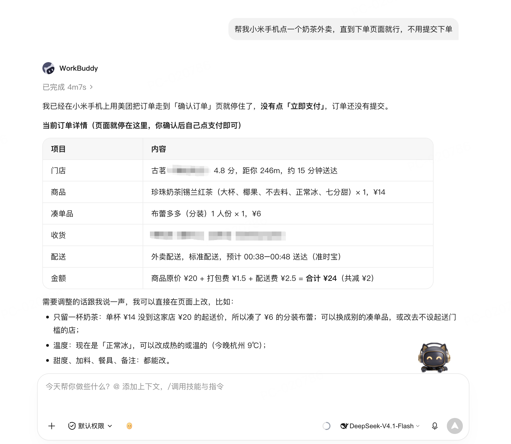
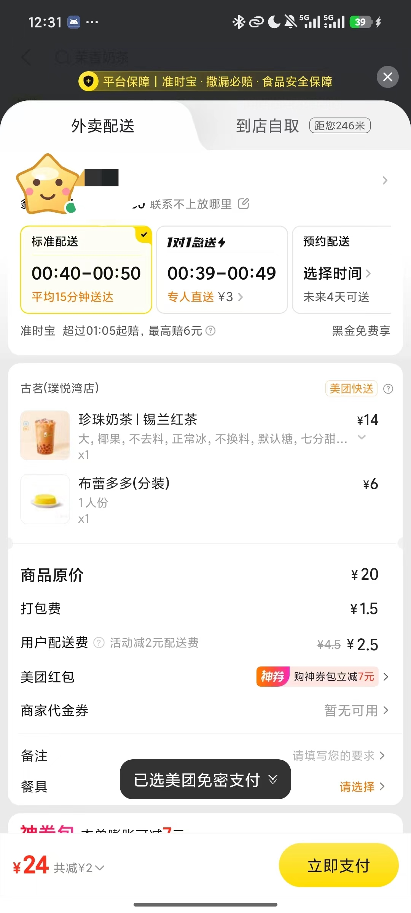

# 场景 01：从一句话到付款前，准备一单奶茶外卖

> 2026-11-20 · WorkBuddy · 小米 Android · 美团

开发果冻最初是为了少点几次“无线调试”。这次实测把同一条手机连接通道用在了生活任务上：让桌面智能体操作手机里的外卖 App，把一单奶茶准备到付款前。

## 用户目标

> 帮我用小米手机点一个奶茶外卖，直到下单页面就行，不用提交下单。

任务刻意把终点放在确认页。商品、价格、配送信息由用户核对，最终提交与付款留给用户决定。

## 实测结果

WorkBuddy 通过果冻查看并操作小米手机，在美团选择奶茶、规格和凑起送价的单品，进入显示“立即支付”的确认页面后停止。它向用户汇报了商品、金额与配送选项，并明确说明**没有点击支付，也没有提交订单**。聊天截图显示这次运行约 4 分钟；这只是单次实测耗时。

## 这次验证了什么

1. 手机和电脑通过 JellyHub 连接，WorkBuddy 从 MCP 获取屏幕与界面元素，并对指定设备执行操作。
2. 智能体在真实 App 中完成了多步选择，还能解释为何加入凑单商品，而不是只反馈“已完成”。
3. 用户设定的停止点得到了遵守：到达付款前页面，交回最终决定权。

这是一次真实使用记录，不代表外卖平台每次改版后都能按相同路径运行。果冻目前也没有通用的下单或支付确认协议；让智能体继续执行最终提交或付款前，应由用户核对订单并另行明确确认。

## 自己试用

按照 [快速开始](../../quickstart.md) 连接 Android 设备，再用 [WorkBuddy 连接器](../../workbuddy-connector-plan.md) 授予目标设备的控制权限。给智能体说明设备、目标 App 和明确的停止点，例如“停在确认页，不要提交或付款”。多设备时指定具体设备，执行关键点击后重新读取屏幕确认状态。

[返回场景索引](../README.md)
